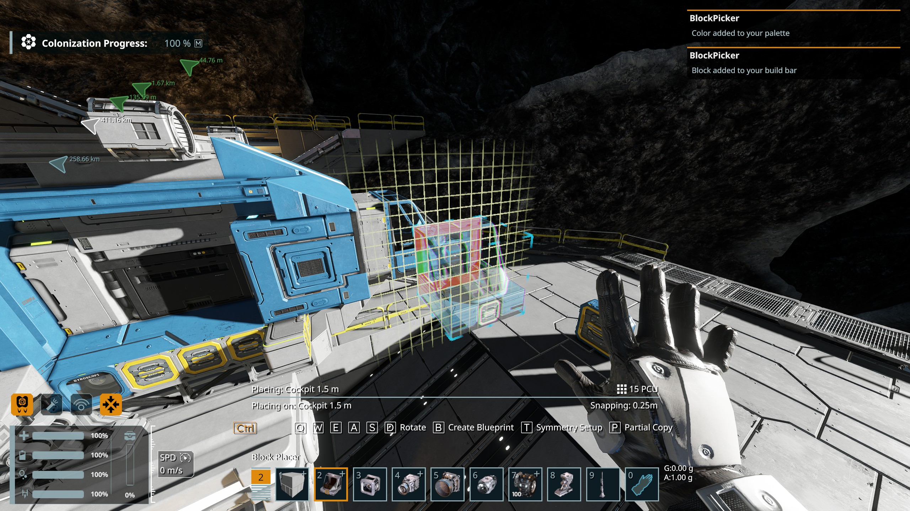
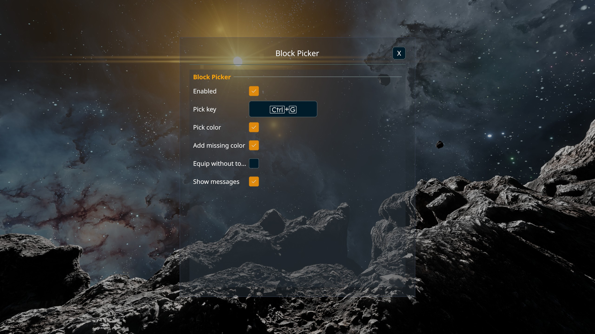

# Space Engineers 2 Block Picker plugin

Inspired by the [SE1 plugin by avaness](https://github.com/austinvaness/BlockPicker)

This plugin allows you to copy the block you are looking at directly to your hands and/or toolbar. Default Keybind is Ctrl+G

Requires the [Pulsar](https://github.com/CometWorks) plugin loader (Modern executable).

## Usage 

While you are holding any block (Has to be a block and not a tool) and you are aiming at the block you want, pressing the keybinding will 
Selects that block on your build bar. If it is not on the bar, it is added to the first free slot and selected, all in one press.

This works on built blocks and projected blocks meaning it will work in surivial.
It also takes survival progression into consideration as blocks you have not unlocked will not be picked.
Picks the block's paint color too, and adds the color to your palette if it is missing.

## Settings

Open them from the plugin list in Pulsar.

| Enabled | Turn the plugin on or off |
| Pick key | The key combination, can be re-bound |
| Pick color | Also pick the paint color of the block |
| Add missing color | Add the color to your palette if it is not there (replaces the currently selected palette color) |
| Equip without toolbar | Hold the block without selecting or adding it on the build bar |
| Show messages | Show small on-screen notices (for example "Block picked") |

## Install

1. Install Pulsar and start the game through the **Modern** executable.
2. Open the plugin list in Pulsar, find **Block Picker by NorthyPark** and enable it.
3. Restart the game when Pulsar asks.

Pulsar compiles the plugin on your own computer, so there is nothing to download separately.

## Reporting problems

Open an issue on this repository and attach Pulsar's `info.log` and the game log.

## Credits, license and Disclaimers

Claude AI was used to make the code, as I do not have the technical still at the moment to make this myself within a resonable timeframe. 

Built from the [CometWorks client2 plugin template](https://github.com/CometWorks/client2-plugin-template). MIT license, see `LICENSE`.

